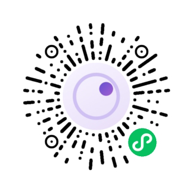

# 60 人格倾向评估 · 双端

一个项目，两个壳：网页版和微信小程序版。两边共用同一套 60 道题、同一套计分与一致性检验，所以同一份作答在两边算出来的百分比完全一致。

没有服务器、没有账号、没有网络请求。所有数据留在用户自己的设备上。

**在线试用**：https://60.2x.work/

<p align="center">
  
  <br>
  <sub>微信扫码，直接在手机上做一遍</sub>
</p>

> **为什么是 60 题？** 见 [`docs/why-60.md`](docs/why-60.md)——题量与信度的关系、加题的边际收益、以及二分法本身的天花板，附出处。结论：60 是这套工具的结构常数，长期不需要增删。

## 目录

```
MBTI双端/
├── core/          唯一的数据与算法来源（7 个文件）
├── build.js       同步脚本：core → web/core、weapp/core
├── web/           网页版，双击 index.html 就能用（Pages 发布的就是这个目录）
├── weapp/         小程序版，用微信开发者工具导入这个目录
├── design/        小程序头像与小程序码（SVG 源 + 1024×1024 PNG）
├── docs/          为什么是 60 题（题量与信度的论证）
├── DEPLOY.md      部署指南：GitHub Pages + 腾讯云域名
└── .github/       GitHub Actions：只把 web/ 发布到 Pages
```

部署、自定义域名、HTTPS 排错、以及上线前清单，都写在 **`DEPLOY.md`**。

`core/` 里的 7 个文件是唯一真相。改完题目或文案，必须在项目根目录跑一次：

```bash
node build.js
```

它会把这 7 个文件复制到 `web/core/` 和 `weapp/core/`。直接改副本，下次同步会被覆盖。

## 网页版

- 打开方式：双击 `web/index.html`，或把 `web/` 整个目录传到任意静态托管
- 标题自动取当前域名，不用手工改；想固定就改 `web/assets/site.js`
- 首页那块小程序码：把小程序的码存成 `web/assets/wx-qrcode.png` 放进去即可，**缺文件时整块卡片隐藏**（不是显示占位）
- 同一张码另存一份到 `weapp/assets/wx-qrcode.png`，结果卡底部的码用的就是它；小程序端缺图时会画虚线占位框
- 上面那张展示用的是 `design/miniprogram-code.png`——白底 + 四周留静区，专供屏幕扫码用。两张都是同一个码，别拿透明那张放到 README 里，深色主题下会看不见
- 部署：GitHub Pages / Cloudflare Pages 都可以，仓库根目录要是 `index.html`（即把 `web/` 的内容作为根），详见 `DEPLOY.md`
- `.nojekyll` 别删，否则 GitHub Pages 会忽略下划线开头的文件

### 导出（报告第 10 节）

| 形式 | 内容 | 用途 |
|---|---|---|
| AI 解读包 `.md` | 角色约束 + 计分公式 + 60 题原始作答 + 复算校验指令，约 16 KB | 拖进任意 AI 对话框，直接发送 |
| 复制全文 / 复制精简版 | 同上；精简版约 900 字，省掉题干，保留五维数据与矛盾点 | 手机上传不了文件时用 |
| JSON | 60 题作答 + 维度百分比 + 一致性分数 + 命中规则 | 存档、写脚本、二次分析 |
| PDF | 完整报告，约 7 页 | 发给别人看；文件名取当前域名 |

`web/assets/report.js` 的 `secHead` 只决定「这一节叫什么」，最终编号由 `renumber()` 按实际出现顺序重排（`<span class="num">` 会被重新编号）。小程序端对应 `weapp/utils/reportData.js` 里的 `no` 对象，同样是按 WXML 渲染顺序递增。**两边都是动态的，所以隐藏某一节不会再出现 02 直接跳 09 的断号。**

### 信息量闸门（重要）

`core/analyzer.js` 的 `score()` 会返回 `info.lowInfo`。触发条件二选一：

| 条件 | 含义 | `reason` |
|---|---|---|
| 中立率 ≥ 45% **且** `clarity < 25` | 大量回避表态 | `neutral` |
| `clarity < 8` | 五维全部贴着 50%，没有任何方向 | `flat` |

`clarity = 五维与 50% 的平均距离 × 2`，满格 100，全中线为 0。

为什么要这道闸门：平局时 tie-break 一律取 plus 极，所以「无差别作答」（全选中立、全选同一档、甚至一题未答）本来都会被判成一个看起来很确定的类型——**全选中立会得到 ENTJ-A 且一致性 100·高**，五维全是 50%。这是纯粹的假象，必须拦住。

触发后两端的行为：

- 报告顶部不给类型代码，显示「—」+「无法定位类型」
- 隐藏 03–08 全部类型详解，替换成「为什么这次不给类型」一节
- 隐藏 AI 解读包与「生成结果卡」（两者都基于类型，会给错内容）
- 保留 01 五维、星座节、作答明细、重新测试
- 小程序端额外：不写入历史（否则列表里会出现一个自己都不认的类型），导航栏标题改成「无法定位类型」
- 折叠区仍会给出 `info.forcedCode`，但明确标注「仅供参考，不说明你是这一型」

改阈值时跑这两个检查：500 份「有偏向」的模拟作答不应有误伤；全选中立 / 全选端点 / 全未答必须全部落在 `lowInfo`。

## 小程序版

用微信开发者工具「导入项目」，目录选到 `weapp/`（不是仓库根，要选到有 `app.json` 的那一层）。

**仓库里的 `appid` 是 `touristappid`（游客模式），真实 AppID 不在仓库里。** 微信的配置文件是两层，`project.private.config.json` 的同名配置会覆盖 `project.config.json`：

| 文件 | 在仓库里？ | 内容 |
|---|---|---|
| `weapp/project.config.json` | 是 | 公共配置，`appid` = `touristappid` |
| `weapp/project.private.config.json` | **否**，已进 `.gitignore` | 你的真实 AppID、本地界面设置 |

clone 下来直接能编译、能真机预览，但**不能上传、不能发布、不能生成小程序码**。要上传，在 `project.private.config.json` 里加一行就行：

```json
{ "appid": "你的 AppID" }
```

这个优先级是微信官方文档写明的：private 里的 `appid` 生效，且不会反过来覆盖 `project.config.json`。所以本地照常上传，仓库里永远只有占位值。**注意别把私钥和 AppSecret 写进任何会提交的文件。**

### 调试的三层

1. **模拟器** —— 写代码时用。改完保存就热更新，看结构和报错。
2. **真机预览** —— 点工具栏「预览」，手机微信扫码。这一层才能看出真实渲染。
3. **真机调试** —— 点「真机调试」，手机上会带 vConsole，能看日志、能选中元素查尺寸。

### 必须真机才能确认的四件事

- 结果卡：canvas 导出的图在模拟器里通常比真机好看。重点看字体有没有回退、右下角小程序码糊不糊、750×1334 有没有白边
- 保存到相册：第一次授权弹窗的样子，以及用户点「拒绝」之后有没有正确跳到设置页
- iPhone 刘海与底部横条：答题页「下一题」按钮会不会被遮住
- 报告页长滚动：十个小节连起来滑，会不会卡

### 页面

| 页面 | 路径 | 说明 |
|---|---|---|
| 首页 | `pages/index` | 进入测试、继续上次、查看上次结果、历史入口 |
| 档案 | `pages/profile` | 昵称 / 生日 / 性别，全部选填 |
| 答题 | `pages/quiz` | 60 题，7 级圆点，选完自动翻页 |
| 报告 | `pages/report` | 与网页版同结构的小节，可展开作答明细 |
| 结果卡 | `pages/result` | canvas 生成 750×1334 的图，可存相册 |
| 历史 | `pages/history` | 本机最近 20 条，点开可重算回看 |

### 本地存储

- 网页版：草稿与档案在 `mbti-local.v1`，主题在 `mbti-local.theme`
- 小程序草稿：`mbti.draft.v1`
- 小程序历史：`mbti.history.v1`（最多 20 条，只存答案和档案，报告每次重算）
- 清缓存会丢，这是刻意的，不做云端同步

### 文案分工

- `web/guide.html` 写给**答题者**看：这份测试是什么、报告有什么、数据在哪、怎么交给 AI。不出现目录结构、构建命令、文件路径。
- `README.md`（本文）写给**开发者**看：目录、`build.js`、AppID、小程序码替换、键名。
- 改文案时不要互相串台——把构建细节写进 guide，用户会以为要自己跑命令。

## 不做什么

- 不做答案码 / 存档码那种长字符串
- 不把报告上传到任何地方
- 不宣称「题库权威」「专业心理测评」——题目是自编的，结构参考公开框架
